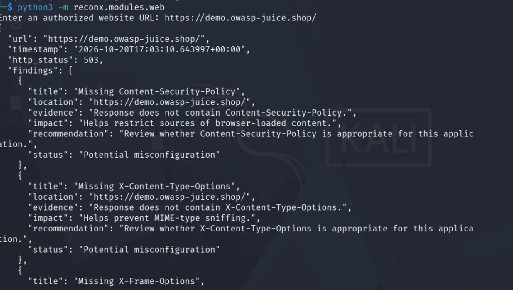

# ReconX


A modular Python toolkit that runs DNS, TLS, web-header and network checks against a target, then produces JSON and HTML reports with severity, confidence, evidence and fix recommendations. It also includes a small Flask dashboard.

**This is my second cybersecurity project**, and the successor to [AutoRecon](https://github.com/<your-username>/autorecon). Where AutoRecon was a single script, ReconX is split into modules that share one finding format. It is still a learning project, not a full vulnerability scanner.

---

## Please read this first

Only assess systems you own or have written permission to test. ReconX asks you to confirm authorization before every run, and enforces some limits in code:

- **Port scanning is limited to loopback/private addresses** (your own machine or lab network).
- **The web module sends a single GET request.** No payloads, fuzzing or exploitation.
- **The dashboard binds to `127.0.0.1` only.**

Safe things to practice on:

- A local [OWASP Juice Shop](https://github.com/juice-shop/juice-shop) container on `127.0.0.1:3000`
- DVWA or Metasploitable in your own isolated lab
- Domains you own

Do not point automated tools at the public Juice Shop demo; it is not meant for scanning.

---

## What it does

| Module | Checks |
|--------|--------|
| `dns` | A, AAAA, CNAME, MX, NS, TXT, SOA records (falls back to the parent zone for NS/TXT/SOA), missing SPF and DMARC |
| `tls` | Certificate validation, expiry, negotiated protocol and cipher |
| `web` | Missing security headers, HSTS, cookie flags, technology disclosure, permissive CORS |
| `network` | Threaded TCP connect scan, flags risky services (Telnet, FTP, SMB, databases) |
| `report` | JSON + HTML reports sorted by severity |
| `app.py` | Flask dashboard to run checks and view reports |

---

## Screenshots

The web module running from the terminal:



---

## Getting started

**1. Clone the repo**

```bash
git clone https://github.com/<your-username>/reconx.git
cd reconx
```

**2. Create and activate a virtual environment**

```bash
python3 -m venv venv
source venv/bin/activate
```

**3. Install dependencies**

```bash
pip install -r requirements.txt
```

**4. (Optional) Start a local Juice Shop lab**

```bash
sudo docker run -d --name juice-shop -p 127.0.0.1:3000:3000 bkimminich/juice-shop
```

---

## Running it

### Command line

```bash
python3 reconx.py http://127.0.0.1:3000 -m web,network -p 3000,8080 --yes
```

| Option | Meaning |
|--------|---------|
| `target` | URL, hostname or IP (asked interactively if omitted) |
| `-m, --modules` | `dns,tls,web,network` (default: all) |
| `-p, --ports` | e.g. `80,443,3000-3010` (max 1024 ports) |
| `--yes` | Confirm you are authorized |
| `-o, --out` | Report folder (default `reports/`) |

DNS is skipped for IP targets and TLS is skipped for non-HTTPS targets; the report says so.

### Run one module on its own

```bash
python3 -m reconx.modules.dns
python3 -m reconx.modules.web
python3 -m reconx.modules.tls
python3 -m reconx.modules.network
```

### Dashboard

```bash
python3 app.py
```

Open `http://127.0.0.1:5000`, enter a target, tick the authorization box and choose modules.

---

## Sample finding

```json
{
  "module": "web",
  "title": "Missing Content-Security-Policy",
  "severity": "medium",
  "confidence": "medium",
  "location": "http://127.0.0.1:3000/",
  "evidence": "Response does not contain Content-Security-Policy.",
  "impact": "Helps restrict sources of browser-loaded content and limits XSS impact.",
  "recommendation": "Review and add Content-Security-Policy if appropriate for this application."
}
```

A missing header is a potential misconfiguration, not proof of an exploitable vulnerability.

---

## Tests

```bash
python3 -m unittest discover -s tests -t . -v
```

The tests start their own local HTTP server, so they run offline.

---

## Project structure

```
reconx/
├── reconx.py              # command-line entry point
├── app.py                 # Flask dashboard
├── reconx/
│   ├── __init__.py
│   ├── core.py            # runs the modules
│   ├── safety.py          # target validation and scope rules
│   ├── findings.py        # shared finding format
│   ├── report.py          # JSON and HTML reports
│   ├── modules/
│   │   ├── __init__.py
│   │   ├── dns.py
│   │   ├── tls.py
│   │   ├── web.py
│   │   └── network.py
│   └── templates/
│       ├── dashboard.html
│       └── report.html
├── tests/
│   ├── __init__.py
│   └── test_reconx.py
├── images/
│   ├── ReconX_web_module_output.png
│   ├── AutoRecon_repo_structure.png
│   └── AutoRecon_image_naming.png
├── reports/
├── requirements.txt
├── .gitignore
├── LICENSE
└── README.md
```

---

## What I learned

- Why NS, TXT and SOA records often live at the parent zone, not the hostname
- How to split a script into modules that share one data format
- Why scope and authorization checks belong in code, not just in a README
- How cookie flags and CORS settings affect browser security
- Escaping output in HTML reports so scan data cannot inject markup

---

## What it can't do (yet)

- No vulnerability exploitation, SQL injection or XSS testing
- No service version detection; TCP connect scan only
- Web checks cover one URL and do not follow redirects or crawl
- TLS check reports the negotiated protocol, not every supported one
- Findings are potential issues to review, not a penetration test

For real assessments, use mature tools such as [Nmap](https://nmap.org/) and [OWASP ZAP](https://www.zaproxy.org/).

---

## What I want to build next

- [ ] Compare results against OWASP ZAP on my local Juice Shop
- [ ] Crawl and check multiple pages
- [ ] List all supported TLS versions
- [ ] Service banner identification
- [ ] PDF export
- [ ] Scan history in the dashboard

---

## About me

I'm **Your Name**, learning cybersecurity and building projects to understand how things really work.

- GitHub: [@your-username](https://github.com/your-username)
- LinkedIn: [your-profile](https://linkedin.com/in/your-profile)

---

## License

MIT License. See the `LICENSE` file.

## Thanks to

- [OWASP Juice Shop](https://github.com/juice-shop/juice-shop) for a safe practice target
- [dnspython](https://www.dnspython.org/), [Requests](https://requests.readthedocs.io/), [Flask](https://flask.palletsprojects.com/)
- [Kali Linux](https://www.kali.org/) for the testing environment
